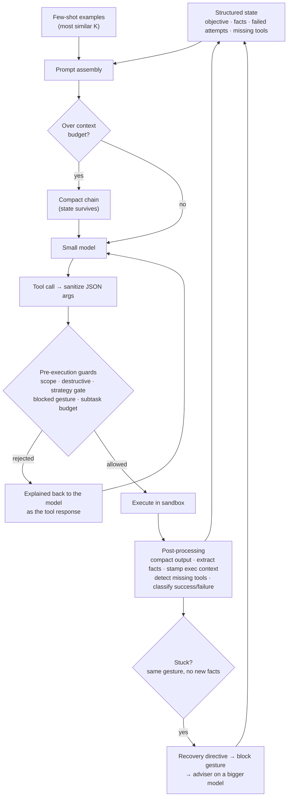

# PentAGI-SLM

**PentAGI, hardened for small local models.**

PentAGI-SLM is a fork of [vxcontrol/pentagi](https://github.com/vxcontrol/pentagi), the autonomous AI penetration-testing agent, that makes it usable with small language models (roughly 8B–32B, served locally by Ollama or vLLM). It adds an opt-in **small-model mode** that wraps the agent loop in deterministic, code-managed guardrails: a context budget, a structured state the model cannot forget, pre-processed tool output, pre-execution guards, loop detection with escalation, and a CPU classifier for closed-set decisions.

> **This is not weight fine-tuning.** No model is trained here. The "tuning" is in the harness around the model: what it sees, what it is allowed to run, and what happens when it gets stuck. Any model PentAGI already supports can be dropped in.

Everything is gated behind `SMALL_MODEL_MODE` (off by default). With the flag off, this fork behaves exactly like upstream PentAGI.

> [!WARNING]
> PentAGI runs real offensive tooling. Use it only against systems you own or are explicitly authorized to test, and set `SMALL_MODEL_SCOPE` so the verifier keeps the agent on target.

---

## Contents

- [Why small models fail in agent loops](#why-small-models-fail-in-agent-loops)
- [How it works](#how-it-works)
- [Quick start](#quick-start)
- [Configuration](#configuration)
- [The mechanisms](#the-mechanisms)
- [Measuring it](#measuring-it)
- [Repository layout](#repository-layout)
- [Build and test](#build-and-test)
- [Known gaps and next steps](#known-gaps-and-next-steps)
- [Provider reference](#provider-reference)
- [Credits and license](#credits-and-license)

---

## Why small models fail in agent loops

A large model can carry a long pentest session in its context and correct itself. A small one cannot: the gap between a good and a bad harness is far wider than the gap between two models. Every mechanism in this fork answers a failure that was observed in real runs.

| Failure observed with a small model | What small-model mode does |
|---|---|
| Context fills up; early findings (open ports, versions) are lost to compaction | A token budget enforced before every model call, plus a **structured state** built by code and re-injected every turn, so facts survive compaction |
| Raw tool output (nmap, long logs) floods the window | nmap XML is parsed into a few lines, other long output is cut to head + tail, and IPs, ports, banners and CVEs are extracted by regex |
| Malformed JSON in tool-call arguments | Arguments are sanitized and validated before execution; the existing repair path stays as a second line |
| Writes a correct tool call as message text (a ` ```json ` block) instead of a structured call, until the reflector gives up and the task aborts | Calls written as text are recovered and run as real tool calls, through the same guards |
| Keeps varying a dead approach (new timeout, new wrapper, same script) instead of abandoning it | Commands are reduced to their canonical shape; repetition **without new facts** triggers a recovery directive, then blocks the gesture outright if the model ignores it |
| Runs a tool that isn't installed (`sshpass: not found`) over and over | The "command not found" signal is lifted into the state, where it stays visible above compaction |
| Reads `id` → `root` in its own sandbox and believes it owns the target (one run fabricated a captured flag this way) | Every terminal result is stamped with where it actually ran |
| Opens with a wordlist brute-force, even when the task hands it a credential (one flow ground `hydra` for a day) | A strategy gate holds back `-P`/`-L` wordlist attacks until recon is done and no credential is in hand |
| A "do not stop until…" instruction runs forever (one subtask: 935 commands over several days) | A hard per-subtask command budget forces the agent to report and conclude |
| Drifts out of scope or proposes destructive commands | A fail-closed verifier checks scope and destructive patterns before anything runs |
| Slow, rambling or hallucinated answers to closed-set choices (which container image?) | A zero-shot classifier on CPU makes the choice instead, with fallback to the model |

## How it works



The design principle throughout: **anything that can be decided by code is decided by code.** The small model plans and chooses actions; facts, budgets, scope, and loop detection are deterministic.

## Quick start

These steps assume you already know how to run upstream PentAGI. For installer details, provider setup, and the web UI, see the [upstream documentation](https://github.com/vxcontrol/pentagi#readme).

### 1. Build the image from this fork

The published `vxcontrol/pentagi` image does not contain these changes, so build locally:

```bash
git clone https://github.com/zSkallywag/pentagiSLM.git
cd pentagiSLM
./scripts/build-image.sh local/pentagi:slm
```

### 2. Configure `.env`

```bash
cp .env.example .env
```

Then set at least:

```bash
PENTAGI_IMAGE=local/pentagi:slm

# Small-model mode
SMALL_MODEL_MODE=true
SMALL_MODEL_CTX_WINDOW=32768            # the real context window of your model
SMALL_MODEL_SCOPE=10.0.0.5/32           # authorized targets: IPs, CIDRs, hostnames

# Your local model
OLLAMA_SERVER_URL=http://<your-ollama-host>:11434
OLLAMA_SERVER_CONFIG_PATH=/opt/pentagi/conf/ollama.provider.yml
PENTAGI_OLLAMA_SERVER_CONFIG_PATH=./my-ollama.provider.yml
```

Everything else has a small-model default (see [Configuration](#configuration)).

### 3. Put a bigger model on the `adviser` and `simple` roles

Small-model mode escalates hard cases to PentAGI's `adviser` agent, and chain summaries are written by the `simple` role (the summarizer and reporter both run on it). If those roles run the same small model, escalation is just a second opinion from the same model and summaries inherit its mistakes. Start from one of the files in [`examples/configs/`](examples/configs/) and override those two roles (model names below are examples):

```yaml
# my-ollama.provider.yml (excerpt)
primary_agent:
  model: "qwen3:14b"          # the small model doing the work
  temperature: 0.2
  max_tokens: 4000

pentester:
  model: "qwen3:14b"
  temperature: 0.2
  max_tokens: 4000

adviser:
  model: "qwen3:32b"          # larger model for escalation
  temperature: 0.3
  max_tokens: 8000

simple:
  model: "qwen3:32b"          # larger model for summaries and reports
  temperature: 0.2
  max_tokens: 8000
```

### 4. (Optional) Start the decision classifier

A DeBERTa-v3 zero-shot classifier behind FastAPI, CPU-only so it never competes with the GPU serving your agent model. The model is baked into the image at build time.

```bash
cd small-model-eval/classifier-sidecar
docker build -t pentagi-classifier .
docker run -d --name pentagi-classifier --network pentagi-network -p 8077:8077 pentagi-classifier
curl http://localhost:8077/health
```

Then in `.env`:

```bash
SMALL_MODEL_CLASSIFIER_URL=http://pentagi-classifier:8077
```

(Create the network first with `docker network create pentagi-network` if PentAGI is not running yet, or start the sidecar after `docker compose up`.)

### 5. Run

```bash
docker compose up -d
docker compose logs pentagi | grep "small-model profile active"
```

At boot the backend logs one line with the resolved profile (verifier, subtask cap, classifier URL, context window, scope), so you can confirm the mode is actually on.

## Configuration

All variables are already wired through `docker-compose.yml` and listed in `.env.example`.

| Variable | Default | What it does |
|---|---|---|
| `SMALL_MODEL_MODE` | `false` | Master switch. When off, nothing below has any effect. |
| `SMALL_MODEL_CTX_WINDOW` | `32768` | Declared context window of your model, in tokens. |
| `SMALL_MODEL_CTX_BUDGET_PERCENT` | `40` | Compact the chain when the prompt exceeds this share of the window. |
| `SMALL_MODEL_BYTES_PER_TOKEN` | `3` | Conservative bytes-per-token estimate used to count tokens. |
| `SMALL_MODEL_TOOL_OUTPUT_MAX_BYTES` | `6144` | Maximum tool output that enters the chain after compaction. |
| `SMALL_MODEL_VERIFIER_ENABLED` | `true` | Scope/destructive verifier and strategy gate. Only an explicit `false` turns them off. |
| `SMALL_MODEL_SUBTASK_MAX_COMMANDS` | `150` | Terminal commands per subtask before it must conclude. `0` disables the cap. |
| `SMALL_MODEL_SCOPE` | empty | Comma-separated IPs, CIDRs or hostnames the agent may target. Empty disables scope checks. |
| `SMALL_MODEL_DENIED_COMMANDS` | empty | Extra destructive substrings, comma-separated, added to the built-in list (`rm -rf /`, `mkfs`, `dd if=`, `shutdown`, …). |
| `SMALL_MODEL_FEWSHOT_FILE` | empty | Path to a JSON array of `{"input": …, "output": …}` examples. Empty disables few-shot. |
| `SMALL_MODEL_FEWSHOT_K` | `3` | How many of the most similar examples are prepended each turn. |
| `SMALL_MODEL_CLASSIFIER_URL` | empty | Base URL of the classifier sidecar. Empty keeps those decisions on the model. |

**What the profile changes for you.** When `SMALL_MODEL_MODE=true`, settings you leave blank are set to small-model starting points. Any value you set explicitly always wins.

| Setting | Upstream default | Small-model profile |
|---|---|---|
| `SUMMARIZER_LAST_SEC_BYTES` | 50 KB | 22 KB |
| `SUMMARIZER_MAX_BP_BYTES` | 16 KB | 7 KB |
| `SUMMARIZER_MAX_QA_SECTIONS` | 10 | 4 |
| `SUMMARIZER_MAX_QA_BYTES` | 64 KB | 22 KB |
| `EXECUTION_MONITOR_ENABLED` | off | on |
| `EXECUTION_MONITOR_SAME_TOOL_LIMIT` | 5 | 3 |
| `EXECUTION_MONITOR_TOTAL_TOOL_LIMIT` | 10 | 8 |

Blank and unset are treated the same, because docker-compose passes unset variables as empty strings.

## The mechanisms

A short tour. [`SMALL_MODEL_TUNING.md`](SMALL_MODEL_TUNING.md) has the full design notes with file and function references.

**Context budget and structured state.** Before each model call the chain is measured against `CTX_BUDGET_PERCENT` of the window and compacted if needed. A code-built state block (objective, established facts, failed attempts, missing tools, next step) is prepended on every turn, so it survives any compaction. The state is keyed by flow and task, which makes it the channel between PentAGI's specialized agents instead of a long shared history.

**Deterministic facts and tool-output compaction.** Tool output is processed before it enters the chain: nmap `-oX` XML becomes a few lines, other long output keeps its head and tail (the useful part of a log is often at the end), and regexes pull IPs, ports, service banners, CVEs and labelled `user:pass` credentials into the state. No model is involved, so nothing drifts.

**Tool-call hygiene.** Every tool call's arguments are sanitized for JSON control characters before execution, keeping the sanitized form only if it is valid JSON. When a tool call is orphaned, the repair message now tells the model the call may have partially run and to verify state before retrying, instead of "please try again".

**Tool-call recovery.** A small model often knows which tool to call and writes correct JSON for it, but sends it as message text: in a ` ```json ` block, inside `<tool_call>` tags, or bare. Upstream treats that as prose and hands it to the reflector, and the same model tends to fail every reflector round the same way until the chain aborts. In small-model mode, a reply with no structured tool calls is searched for JSON shaped `{"name": …, "arguments": {…}}` (also `parameters`, and the OpenAI `{"function": {…}}` wrapper). A match is promoted to a real tool call only if the name is one of the agent's tools and the arguments are a JSON object. Recovered calls go through the pre-execution guards like any other call, and each recovery is logged as `recovered tool call from content`. The assistant agent is left alone, since it may legitimately answer in prose.

**Pre-execution guards.** Four checks run before any command, and each rejection is explained back to the model as the tool response:
- *Verifier:* destructive patterns and out-of-scope targets are blocked, fail-closed.
- *Strategy gate:* a wordlist attack (`hydra`, `medusa`, `ncrack`, `patator` with `-P`/`-L`) is held back if the state already holds a credential or shows no recon yet. Single targeted attempts (`-p one -l user`) always pass. It fires at most once per task, then trusts the agent.
- *Blocked gestures:* a command shape the model kept repeating after being told to stop (see below).
- *Subtask budget:* the per-subtask command cap. Reporting and completion tools still pass, so the agent can finish rather than deadlock.

**Loop recovery.** Two triggers arm a recovery directive. The first fires when recent failed attempts (as judged by the classifier) look alike. The second, classifier-independent, fires when the same *canonical gesture* repeats while no new fact has been learned: here-doc bodies and quoted strings become placeholders, paths keep only directory and extension, numbers become `N`, so `/work/a_final.py --timeout 10` and `/work/b_final.py --timeout 20` are the same gesture. A new fact resets the counter, so a brute-force or sweep that is still covering new ground is never flagged. If the model ignores the directive three turns in a row, the gesture is blocked and the execution monitor hands the case to the adviser.

**Missing-tool grounding.** The shell's "command not found" forms (bash, sh/dash, zsh) are parsed out of raw terminal output, before compaction, and pinned in the state. Nothing is installed automatically; the agent's own observation is simply kept where it can't be missed.

**Execution-context stamping.** Each terminal result carries a note that it ran in the PentAGI sandbox as root, and that only ssh or other remote wrappers reach a target.

**Decision classifier.** Closed-set decisions are offloaded to the sidecar. It currently picks the container image for a flow and labels tool output as success or failure. A high-confidence failure is recorded in the state as a grounded failed attempt. This is advisory, not a hard gate.

**Dynamic few-shot.** If you provide an example file, the K examples whose input overlaps most with the current situation are prepended to the prompt.

```json
[
  {
    "input": "nmap shows 22/tcp open ssh and the task gives credentials student:letmein",
    "output": "Authenticate with the provided credentials first: ssh student@<target>. Do not brute-force."
  }
]
```

## Measuring it

With small models, every configuration change has to be measured, not assumed. [`small-model-eval/`](small-model-eval/) contains the methodology:

- **Metrics, in priority order:** task completion, fact fidelity after compaction (ask about details from sections already summarized), malformed tool-call rate, steps to result, and out-of-scope actions blocked.
- **Scenarios:** one YAML file per target with scope, objective, success criteria and fidelity questions. See [`scenarios/example.yaml`](small-model-eval/scenarios/example.yaml).
- **Finding the real context limit:** run the same scenario with `SMALL_MODEL_CTX_BUDGET_PERCENT` at 25, 40 and 60. Where the success rate drops sharply is the model's usable limit; stay one step below it.
- **Change one variable at a time.**

The classifier sidecar ships with head-to-head benchmarks against a generative model on the same cases:

```bash
cd small-model-eval/classifier-sidecar
./bench_images.sh              # classifier: container-image selection
./bench_qwen_images.sh         # same cases, generative model via Ollama
./bench_success.sh             # classifier: success/failure of tool output
./bench_qwen_success.sh        # same cases, generative model
```

### Findings so far

- **Image selection:** the classifier matched the generative model's accuracy while running on CPU, about 2× faster, and deterministically.
- **Success/failure labelling:** classifier and generative model were equally accurate but made *different* mistakes, which is why the signal is advisory and why a disagreement between them is a useful escalation trigger.
- **Missing tools:** on a 13B model, shown the clean `not found` line in a focused prompt, the model installed the tool itself 66% of the time, and 100% with a one-line nudge. In a real flow of hundreds of turns the same model looped indefinitely. The gap was salience, not capability, which is what missing-tool grounding addresses.

## Repository layout

What this fork adds on top of upstream:

```
backend/pkg/smallmodel/          self-contained logic, each file with unit tests
  budget.go                      token budget
  state.go                       structured state store (keyed by flow + task)
  extract.go                     regex fact extraction (IPs, ports, banners, CVEs, credentials)
  toolsummary.go                 tool-output compaction (nmap XML, head + tail)
  verifier.go                    scope and destructive-command checks
  strategygate.go                premature brute-force gate
  recovery.go                    loop detection, command canonicalization, recovery directives
  missingtool.go                 "command not found" detection
  execcontext.go                 execution-context stamp
  classifier.go                  client for the decision sidecar
  fewshot.go                     similarity-ranked few-shot examples
  toolcallrecovery.go            tool calls recovered from message text
backend/pkg/providers/
  small_model.go                 wiring between the flow provider and the package
  performer.go                   call sites: state block, budget, sanitize → guards → compact
  image_selection.go             classifier-based image choice
backend/pkg/config/config.go     SMALL_MODEL_* settings and the profile defaults
backend/pkg/cast/chain_ast.go    improved orphaned-tool-call repair message
small-model-eval/                methodology, scenario format, classifier sidecar and benchmarks
SMALL_MODEL_TUNING.md            full design notes
```

## Build and test

The backend requires Go 1.26 (see `backend/go.mod`); the Docker build takes care of this for you. To run the tests locally:

```bash
cd backend
go build ./...
go test ./pkg/smallmodel/... ./pkg/config/... ./pkg/cast/... ./pkg/csum/... ./pkg/providers/...
```

## Known gaps and next steps

- **Session and target handles.** The execution-context stamp is a first step. The robust version is first-class session/target handles, with verification that a claimed action actually ran where the model says it did.
- **Task-context credentials.** The strategy gate only knows about credentials that appear in tool output. Feeding credentials given in the task description into the state would make it catch the exact flow that motivated it.
- **More classifier decisions.** Allow/deny decisions are the next closed-set choice to offload.
- **"Varied but stuck" loops.** Many different actions, none working, none repeated. Deliberately not detected yet, to avoid flagging slow but genuine exploration.
- **First-class tools for mechanism gaps,** for example non-interactive SSH authentication handled in code instead of left to the model.

## Provider reference

Provider setup is unchanged from upstream. The Gemini and Qwen sections below are kept here because a backend test (`TestCatalog_ReadmeProviderSectionsMatchTheShippedConfig`) checks them against the shipped provider configs. When those configs change upstream, copy the matching sections from the upstream README.

### Google AI (Gemini) Provider Configuration

PentAGI integrates with Google's Gemini models through the Google AI API, offering state-of-the-art multimodal reasoning capabilities with extended thinking and context caching.

#### Configuration Variables

| Variable            | Default                                     | Description                    |
| ------------------- | ------------------------------------------- | ------------------------------ |
| `GEMINI_API_KEY`    |                                             | API key for Google AI services |
| `GEMINI_SERVER_URL` | `https://generativelanguage.googleapis.com` | Google AI API endpoint         |

#### Configuration Examples

```bash
# Basic Gemini setup
GEMINI_API_KEY=your_gemini_api_key
GEMINI_SERVER_URL=https://generativelanguage.googleapis.com

# Using with proxy
GEMINI_API_KEY=your_gemini_api_key
PROXY_URL=http://your-proxy:8080
```

#### Supported Models

PentAGI lists 14 Gemini model IDs that responded through the tested API endpoint. Availability in the catalogue does not mean a model is suitable for every agent role: the saved-chain results below determine the bundled defaults. Models marked with `*` are used in `config.yml`; the [full replay matrix](MODEL_REPLAY_RESULTS.md) describes role and outcome limits.

| Model ID | Thinking | Context | Price (Input/Output/Cache) | Saved-chain result |
| --- | --- | --- | --- | --- |
| `gemini-3.8-flash` | ✅ | 1M | $0.75/$3.75/$0.075 | API responds; 10/10 saved generator calls were content-filtered |
| `gemini-3.7-flash` | ✅ | 1M | $0.75/$3.75/$0.075 | API responds; 10/10 saved generator calls were content-filtered; former default |
| `gemini-3.6-flash` | ✅ | 1M | $0.75/$3.75/$0.075 | API responds; 10/10 saved generator calls returned text without a tool |
| `gemini-3.5-flash` | ✅ | 1M | $1.5/$9/$0.15 | API responds; 10/10 saved generator calls returned text without a tool |
| `gemini-3.5-flash-lite`* | ✅ | 1M | $0.3/$2.5/$0.03 | Complex-role default; eight direct plans and two after a safe `memorist` continuation |
| `gemini-3.1-pro-preview` | ✅ | 1M | $2/$12/$0.2 | API responds; 10/10 saved generator calls returned text without a tool |
| `gemini-3.1-pro-preview-customtools` | ✅ | 1M | $2/$12/$0.2 | API responds; 10/10 saved generator calls returned text without a tool |
| `gemini-3.1-flash-lite`* | ✅ | 1M | $0.25/$1.5/$0.025 | Simple-role default; direct plan on all ten saved generator chains |
| `gemini-3-flash-preview` | ✅ | 1M | $0.5/$3/$0.05 | API responds; three direct plans and five generator timeouts |
| `gemini-2.5-pro` | ✅ | 1M | $1.25/$10/$0.125 | API responds; ten direct plans, but four role-smoke provider errors |
| `gemini-2.5-flash` | ✅ | 1M | $0.3/$2.5/$0.03 | Ten direct plans; access is limited for new API projects |
| `gemini-2.5-flash-lite` | ✅ | 1M | $0.1/$0.4/$0.01 | API responds; five of ten generator answers were empty |
| `gemma-4-31b-it` | ✅ | 256K | Free/Free/Free | API responds; seven direct plans and three generator timeouts |
| `gemma-4-26b-a4b-it` | ✅ | 256K | Free/Free/Free | Direct plan on all ten saved generator chains |

**Prices**: Per 1M tokens. Google [limits Gemini 2.5 access for new projects](https://ai.google.dev/gemini-api/docs/models/gemini-2.5-pro), so PentAGI uses the tested 3.1 Flash-Lite as its fallback and simple-role default. Existing custom 2.5 configurations remain usable where the project has access.

**Default Model Assignments (config.yml)**:
- **`gemini-3.1-flash-lite`** - `simple`, `simple_json`, `reflector`, `searcher`, `enricher`
- **`gemini-3.5-flash-lite`** - `primary_agent`, `assistant`, `generator`, `refiner`, `adviser`, `coder`, `installer`, `pentester`

Both default models passed a basic API/configuration smoke for every role. [Google reports stronger agentic and coding performance for 3.5 Flash-Lite than 3.1 Flash-Lite](https://blog.google/innovation-and-ai/models-and-research/gemini-models/gemini-3-6-flash-3-5-flash-lite-3-5-flash-cyber/); PentAGI's saved production chains cover generator and reflector only, so the smoke does not establish semantic quality or multi-turn reliability for other roles. On two saved generator chains, 3.5 Flash-Lite first chose the allowed `memorist` tool and called `subtask_list` after a synthetic tool response; no real tool was executed in that continuation.

**Reasoning Effort Levels**:
- **High**: Deeper reasoning for planning and review (`primary_agent`, `generator`, `refiner`, `adviser`)
- **Medium**: Balanced reasoning for execution roles (`assistant`, `coder`, `installer`, `pentester`)
- **Not set**: No thinking setting is sent and the model's own default applies (`simple`, `simple_json`, `reflector`, `searcher`, `enricher`)

### Qwen Provider Configuration

PentAGI uses one OpenAI-compatible door for both Qwen Cloud and Alibaba Cloud Model Studio (DashScope). The bundled catalogue is the union of their agent-capable Chat Completions models, while the default role configuration uses only model IDs available on both platforms.

#### Configuration Variables

| Variable           | Default Value                                          | Description                                         |
| ------------------ | ------------------------------------------------------ | --------------------------------------------------- |
| `QWEN_API_KEY`     |                                                        | Qwen Cloud, DashScope, or gateway API key           |
| `QWEN_SERVER_URL`  | `https://dashscope-us.aliyuncs.com/compatible-mode/v1` | Direct API or OpenAI-compatible gateway base URL    |
| `QWEN_PROVIDER`    |                                                        | Gateway route prefix: `qwen_cloud` or `dashscope`   |

#### Configuration Examples

```bash
# Direct Alibaba Cloud Model Studio usage (Global/US endpoint)
QWEN_API_KEY=your_qwen_api_key
QWEN_SERVER_URL=https://dashscope-us.aliyuncs.com/compatible-mode/v1
QWEN_PROVIDER=

# Alternative endpoints
QWEN_SERVER_URL=https://dashscope-intl.aliyuncs.com/compatible-mode/v1  # International (Singapore)
QWEN_SERVER_URL=https://dashscope.aliyuncs.com/compatible-mode/v1       # Chinese Mainland (Beijing)

# Qwen Cloud through LiteLLM
QWEN_API_KEY=your_litellm_key
QWEN_SERVER_URL=http://litellm-proxy:4000
QWEN_PROVIDER=qwen_cloud

# Alibaba Cloud through LiteLLM
QWEN_PROVIDER=dashscope
```

#### Supported Models

PentAGI ships 50 text, reasoning, coding, and vision-language catalogue entries available from at least one of the two platforms. Image generation, video, speech, realtime, translation-only, embedding, reranking, and decision APIs use different protocols or billing units and are not exposed as PentAGI chat models. Prices below are Alibaba Cloud international list rates per 1M tokens where Alibaba offers the model; Qwen Cloud can bill differently.

**Cross-platform model IDs used for portable configuration**

| Availability | Models |
| ------------ | ------ |
| Qwen Cloud and DashScope | `qwen3.8-max`, `qwen3.8-flash`, `qwen3.7-plus`, `qwen3.7-max`, `qwen3.6-flash`, `deepseek-v4.1-flash`, `deepseek-v4-pro` |
| Qwen Cloud only | `deepseek-v4-pro-0813` |
| DashScope only | All other entries in the bundled catalogue |

**Flagship Models (Top-tier Reasoning)**

| Model ID                     | Thinking | Intl | Global/US | China | Price (Input/Output/Cache) | Use Case                                                |
| ---------------------------- | -------- | ---- | --------- | ----- | -------------------------- | ------------------------------------------------------- |
| `qwen3.8-max`                | ✅        | —    | —         | —     | $2.00/$6.00/$0.25          | Newest flagship succeeding Qwen3.7-Max                  |
| `qwen3.8-omni-flash`         | ✅        | ✅    | ✅         | ✅     | $0.15/$0.47/—              | Current multimodal Omni tier                            |
| `qwen3.7-max`                | ✅        | ✅    | ✅         | ✅     | $2.50/$7.50/$0.50          | Next-gen flagship for agent-centric era                 |
| `qwen3.6-max-preview`        | ✅        | ✅    | ✅         | ✅     | $1.30/$7.80/$0.13          | Preview Max with enhanced vibe coding & front-end skills |
| `qwen3-max`                  | ✅        | ✅    | ✅         | ✅     | $1.20/$6.00/$0.24          | Previous-gen flagship with agent programming upgrades   |
| `qwen-max`                   | ❌        | ✅    | ✅         | ✅     | $1.60/$6.40/—              | Legacy 32K text flagship                                |
| `qwen-plus`                  | ✅        | ✅    | ✅         | ✅     | $0.40/$4.00/$0.08          | Qwen3-backbone Plus with switchable thinking modes      |

**Balanced Plus Models (Mid-tier)**

| Model ID                     | Thinking | Intl | Global/US | China | Price (Input/Output/Cache) | Use Case                                                |
| ---------------------------- | -------- | ---- | --------- | ----- | -------------------------- | ------------------------------------------------------- |
| `qwen3.7-plus`               | ✅        | —    | —         | —     | $0.40/$1.60/$0.08          | Cost-efficient tier of the Qwen3.7 generation           |
| `qwen3.6-plus`               | ✅        | ✅    | ✅         | ✅     | $0.50/$3.00/$0.05          | Native VL Plus with agentic coding                      |
| `qwen3.5-plus`               | ✅        | ✅    | ✅         | ✅     | $0.40/$2.40/$0.04          | Previous-gen native VL with strong multimodal capabilities |

**Fast Flash Models (Cost-optimized)**

| Model ID                     | Thinking | Intl | Global/US | China | Price (Input/Output/Cache) | Use Case                                                |
| ---------------------------- | -------- | ---- | --------- | ----- | -------------------------- | ------------------------------------------------------- |
| `qwen3.8-flash`              | ✅        | —    | —         | —     | $0.15/$0.47/$0.016         | Cost-efficient tier of the Qwen3.8 generation           |
| `qwen3.7-flash`              | ✅        | —    | —         | —     | $0.03/$0.13/$0.02          | Low-latency tier of the Qwen3.7 generation              |
| `qwen3.6-flash`*             | ✅        | ✅    | ✅         | ✅     | $0.25/$1.50/$0.05          | Shared utility model                                    |
| `qwen3.5-flash`              | ✅        | ✅    | ✅         | ✅     | $0.10/$0.40/$0.01          | Ultra-fast lightweight                                  |
| `qwen-flash`                 | ✅        | ✅    | ✅         | ✅     | $0.05/$0.40/$0.01          | Qwen3-series Flash with 1M context, tiered pricing      |

**Code-Specialized Models**

| Model ID                     | Thinking | Intl | Global/US | China | Price (Input/Output/Cache) | Use Case                                                |
| ---------------------------- | -------- | ---- | --------- | ----- | -------------------------- | ------------------------------------------------------- |
| `qwen3-coder-plus`           | ❌        | ✅    | ✅         | ✅     | $1.00/$5.00/$0.20          | Strong coding agent with autonomous programming         |
| `qwen3-coder-flash`          | ❌        | ✅    | ✅         | ✅     | $0.30/$1.50/$0.06          | Fast code-gen with multi-turn tool stability            |
| `qwen3-coder-next`           | ❌        | ✅    | ✅         | ✅     | $0.30/$1.50/—              | Open-source code generation, SOTA at same scale         |

**Vision-Language Models (Browser & Screenshot Analysis)**

| Model ID                     | Thinking | Intl | Global/US | China | Price (Input/Output/Cache) | Use Case                                                |
| ---------------------------- | -------- | ---- | --------- | ----- | -------------------------- | ------------------------------------------------------- |
| `qwen3-vl-plus`              | ✅        | ✅    | ✅         | ✅     | $0.20/$1.60/$0.04          | VL with visual agent capabilities, ultra-long video understanding |
| `qwen3-vl-flash`             | ✅        | ✅    | ✅         | ✅     | $0.05/$0.40/$0.01          | Small VL with 2D/3D localization for browser triage     |
| `qvq-max`                    | ✅        | ✅    | ✅         | ✅     | $1.20/$4.80/—              | Visual reasoning with chain-of-thought                  |
| `qwen3-vl-235b-a22b-thinking` | ✅        | —    | —         | —     | $0.40/$4.00/—              | Open-source 235B MoE VL (~22B active) with reasoning    |
| `qwen3-vl-235b-a22b-instruct` | ❌        | —    | —         | —     | $0.40/$1.60/—              | Open-source 235B MoE VL (~22B active), instruction-following |
| `qwen3-vl-32b-instruct`      | ❌        | —    | —         | —     | $0.16/$0.64/—              | Open-source 32B dense VL, instruction-following         |
| `qwen3-vl-30b-a3b-thinking`  | ✅        | —    | —         | —     | $0.20/$2.40/—              | Open-source 30B MoE VL (~3B active) with reasoning      |
| `qwen3-vl-30b-a3b-instruct`  | ❌        | —    | —         | —     | $0.20/$0.80/—              | Open-source 30B MoE VL (~3B active), instruction-following |

**Open-Source Qwen3.8 Series**

| Model ID                     | Thinking | Intl | Global/US | China | Price (Input/Output/Cache) | Use Case                                                |
| ---------------------------- | -------- | ---- | --------- | ----- | -------------------------- | ------------------------------------------------------- |
| `qwen3.8-2.4t-a95b`          | ✅        | —    | —         | —     | $2.00/$6.00/—              | Open-source 3.8 flagship, always reasons                |
| `qwen3.8-27b`                | ✅        | —    | —         | —     | $0.50/$3.00/$0.10          | Dense open-weight 3.8 tier, hybrid thinking, 1M context |

**Open-Source Qwen3.6 Series**

| Model ID                     | Thinking | Intl | Global/US | China | Price (Input/Output/Cache) | Use Case                                                |
| ---------------------------- | -------- | ---- | --------- | ----- | -------------------------- | ------------------------------------------------------- |
| `qwen3.6-27b`                | ✅        | ✅    | ✅         | ✅     | $0.60/$3.60/—              | Native VL on hybrid architecture, on-premises ready     |
| `qwen3.6-35b-a3b`            | ✅        | ✅    | ✅         | ✅     | $0.25/$1.49/—              | Efficient 35B MoE (~3B active) for continuous monitoring |

**Open-Source Qwen3.5 Series**

| Model ID                     | Thinking | Intl | Global/US | China | Price (Input/Output/Cache) | Use Case                                                |
| ---------------------------- | -------- | ---- | --------- | ----- | -------------------------- | ------------------------------------------------------- |
| `qwen3.5-397b-a17b`          | ✅        | ✅    | ✅         | ✅     | $0.60/$3.60/—              | Largest 397B params (~17B active), exceptional reasoning |
| `qwen3.5-122b-a10b`          | ✅        | ✅    | ✅         | ✅     | $0.40/$3.20/—              | Large 122B params (~10B active), strong balance         |
| `qwen3.5-35b-a3b`            | ✅        | ✅    | ✅         | ✅     | $0.25/$2.00/—              | Efficient 35B MoE (~3B active), cost-effective          |
| `qwen3.5-27b`                | ✅        | ✅    | ✅         | ✅     | $0.30/$2.40/—              | Medium 27B with hybrid linear attention + sparse MoE    |

**Open-Source Qwen3 Coder Series**

| Model ID                              | Thinking | Intl | Global/US | China | Price (Input/Output/Cache) | Use Case                                                |
| ------------------------------------- | -------- | ---- | --------- | ----- | -------------------------- | ------------------------------------------------------- |
| `qwen3-coder-480b-a35b-instruct`      | ❌        | ✅    | ✅         | ✅     | $1.50/$7.50/—              | Largest open coder MoE (480B/~35B active)               |
| `qwen3-coder-30b-a3b-instruct`        | ❌        | ✅    | ✅         | ✅     | $0.45/$2.25/—              | Efficient 30B MoE (~3B active), repository-scale        |

**Open-Source Qwen3 Dense & MoE Series**

| Model ID                              | Thinking | Intl | Global/US | China | Price (Input/Output/Cache) | Use Case                                                |
| ------------------------------------- | -------- | ---- | --------- | ----- | -------------------------- | ------------------------------------------------------- |
| `qwen3-next-80b-a3b-thinking`         | ✅        | ✅    | ✅         | ✅     | $0.15/$1.20/—              | Next-gen 80B MoE (~3B active) thinking-only             |
| `qwen3-next-80b-a3b-instruct`         | ❌        | ✅    | ✅         | ✅     | $0.15/$1.20/—              | Next-gen 80B MoE instruction-following                  |
| `qwen3-235b-a22b-thinking-2507`       | ✅        | —    | —         | —     | $0.23/$2.30/—              | 235B MoE (~22B active) thinking variant                 |
| `qwen3-30b-a3b-thinking-2507`         | ✅        | —    | —         | —     | $0.20/$2.40/—              | 30B MoE (~3B active) thinking variant                   |
| `qwen3-30b-a3b-instruct-2507`         | ❌        | —    | —         | —     | $0.20/$0.80/—              | 30B MoE (~3B active) non-thinking variant               |

**Third-Party Models**

These models share the OpenAI-compatible Qwen door. Availability differs by platform; the cross-platform table above is authoritative for portable role configuration.

| Model ID                              | Thinking | Context | Price (Input/Output/Cache) | Use Case                                                |
| ------------------------------------- | -------- | ------- | -------------------------- | ------------------------------------------------------- |
| `glm-5.3-prime`                       | ✅        | 1M      | $2.80/$8.80/—              | DashScope priority GLM route |
| `glm-5.2-fast-preview`                | ✅        | 1M      | $2.80/$8.80/—              | DashScope high-throughput GLM 5.2 route |
| `glm-5.2`                             | ✅        | 1M      | $1.40/$4.40/$0.28          | Zhipu AI GLM flagship route |
| `deepseek-v4.1-flash`*                | ✅        | 1M      | $0.15/$0.60/—              | Current shared low-latency DeepSeek model |
| `deepseek-v4-pro`*                    | ✅        | 1M      | $2.40/$4.80/$0.20          | Shared model for security and tool-heavy roles |
| `deepseek-v4-pro-0813`                | ✅        | 1M      | $2.40/$4.80/$0.20          | Qwen Cloud-only V4 Pro snapshot |
| `deepseek-v4-flash-0731`              | ✅        | 1M      | $0.44/$1.32/$0.088         | Legacy DashScope Flash snapshot |
| `kimi-k3`                             | ✅        | 1M      | $3.00/$15.00/$0.30         | Current Kimi flagship on DashScope |
| `kimi-k2.7-code`                      | ✅        | 262K    | $0.95/$4.00/$0.19          | Moonshot coding model, thinking always on, 16K output ceiling |

**Prices**: Per 1M tokens. Cache pricing reflects implicit cache hit (when available); MoE/dense open-source models do not expose cache pricing. Tiered models (Max/Plus) show lowest-tier pricing (typically ≤32k or ≤256k input); larger contexts incur higher rates per Alibaba Cloud pricing. `deepseek-v4-flash-0731` shows the busy-hours rate; idle hours bill half.

**Region Availability**:
- **Intl** (International): Singapore region (`dashscope-intl.aliyuncs.com`)
- **Global/US**: US Virginia region (`dashscope-us.aliyuncs.com`)
- **China**: Chinese Mainland Beijing region (`dashscope.aliyuncs.com`)
- **—**: availability in that region is not recorded here

**Default Agent Configuration**:
| Agent Role                                                                   | Default Model       | Tier      |
| ---------------------------------------------------------------------------- | ------------------- | --------- |
| `simple`, `simple_json`, `reflector`, `searcher`, `enricher`                 | `qwen3.6-flash`     | Utility   |
| `primary_agent`, `assistant`, `coder`, `installer`, `pentester`              | `deepseek-v4.1-flash` | Workhorse |
| `generator`, `refiner`, `adviser`                                            | `deepseek-v4-pro`   | Planning  |

The role configuration must run unchanged behind `qwen_cloud/` and `dashscope/`. Qwen 3.6 Flash handles utility calls, DeepSeek V4.1 Flash provides the lower-cost workhorse tier, and DeepSeek V4 Pro remains on planning and advice. Thinking controls are left at provider defaults because Qwen Cloud does not accept the same disable operation that DashScope supports.

**Key Features**:
- **Agent-Centric Design**: Qwen3.7-Max is purpose-built for long-horizon autonomous execution and tool invocation
- **Automatic Context Caching**: 30-50% cost reduction on repeated context with implicit cache
- **Extended Thinking**: Chain-of-thought reasoning for complex security analysis (Qwen3.7/3.6/3.5/3-Max, QVQ-Max)
- **Code Specialization**: Qwen3-Coder series with multi-turn tool interaction and repository-level understanding
- **Vision-Language**: Qwen3-VL series for browser screenshot triage, 2D/3D localization, OCR-level analysis
- **Tool Calling**: Seamless integration with 20+ pentesting tools via function calling
- **Streaming**: Real-time response streaming for interactive workflows
- **Multilingual**: Strong Chinese, English, and multi-language support
- **Open-Source Variants**: Dense and MoE models from 27B to 2.4T for on-premises/air-gapped deployments

**LiteLLM Integration**: Set `QWEN_PROVIDER=qwen_cloud` for Qwen Cloud routes or `QWEN_PROVIDER=dashscope` for Alibaba Cloud routes. Leave it empty for direct DashScope API usage.

#### Alternative Integrations

DashScope is fully OpenAI-compatible, so Qwen can also power two other PentAGI subsystems through the standard OpenAI client.

**As embedding provider** (`text-embedding-v4`, see [Alibaba Cloud Model Studio pricing](https://modelstudio.console.alibabacloud.com/ap-southeast-1?tab=doc#/doc/?type=model&url=prices)):

```bash
EMBEDDING_PROVIDER=openai
EMBEDDING_URL=https://dashscope-intl.aliyuncs.com/compatible-mode/v1  # International (Singapore)
# EMBEDDING_URL=https://dashscope.aliyuncs.com/compatible-mode/v1     # Chinese Mainland
EMBEDDING_KEY=sk-*******
EMBEDDING_MODEL=text-embedding-v4
EMBEDDING_BATCH_SIZE=         # optional, default applies
EMBEDDING_STRIP_NEW_LINES=    # optional, default applies
```

> Note: the Global/US DashScope endpoint (`dashscope-us.aliyuncs.com`) does **not** expose embedding APIs — use the International or China endpoints for `text-embedding-v4`.

**As OpenAI-typed custom LLM provider**: instead of the dedicated `QWEN_*` variables, you can wire any Qwen chat model through PentAGI's custom OpenAI-compatible provider by pointing `OPENAI_SERVER_URL` (or a custom provider entry) to the DashScope `/compatible-mode/v1` endpoint and selecting the desired Qwen model name. Useful when you already manage all model traffic through a single OpenAI-shaped client (e.g. shared with LiteLLM/OneAPI proxies).

### Other providers

OpenAI, Anthropic, AWS Bedrock, Ollama, DeepSeek, GLM, Kimi, MiniMax, Mistral, xAI and custom OpenAI-compatible endpoints are documented in the [upstream README](https://github.com/vxcontrol/pentagi#readme).

## Credits and license

Built on [PentAGI](https://github.com/vxcontrol/pentagi) by the PentAGI Development Team / VXControl. All of the agent system, UI, and infrastructure is theirs; this fork adds the small-model layer described above. For everything not covered here, the upstream documentation applies.

Licensed under the [MIT License](LICENSE), Copyright (c) 2025 PentAGI Development Team. See [EULA.md](EULA.md) and [NOTICE](NOTICE) for the upstream terms, including the separate terms for VXControl Cloud services.
